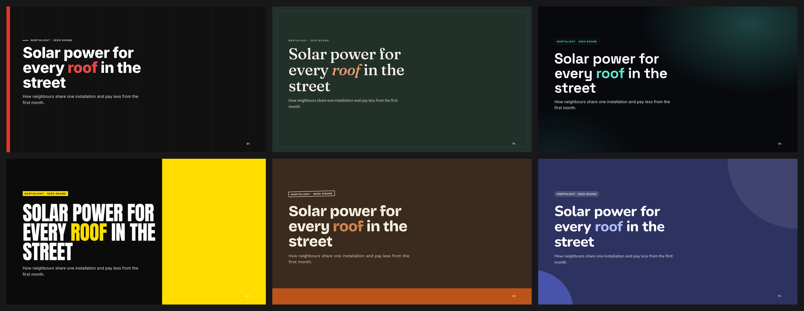
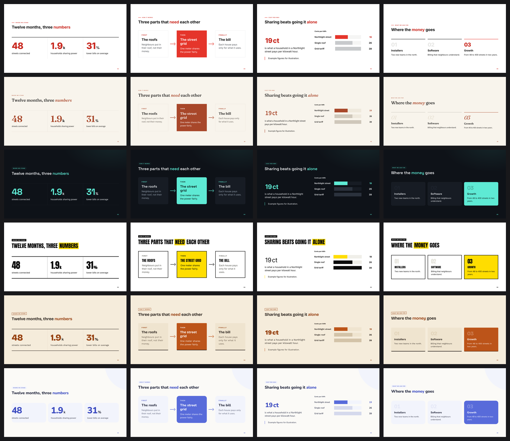
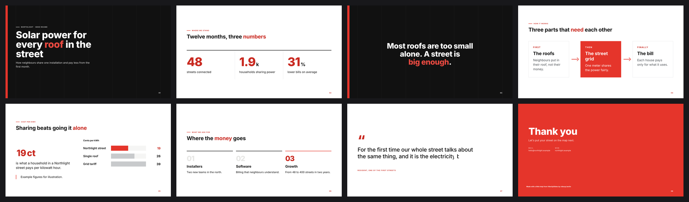
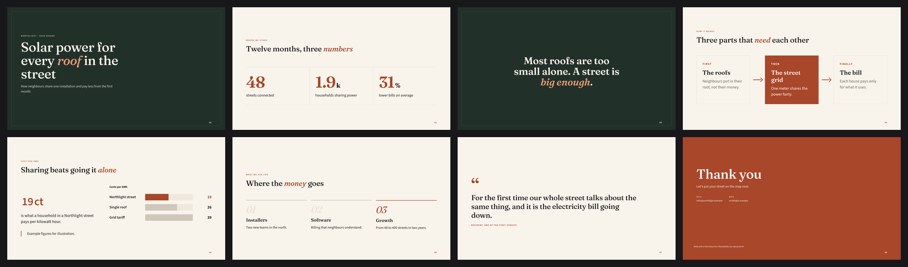
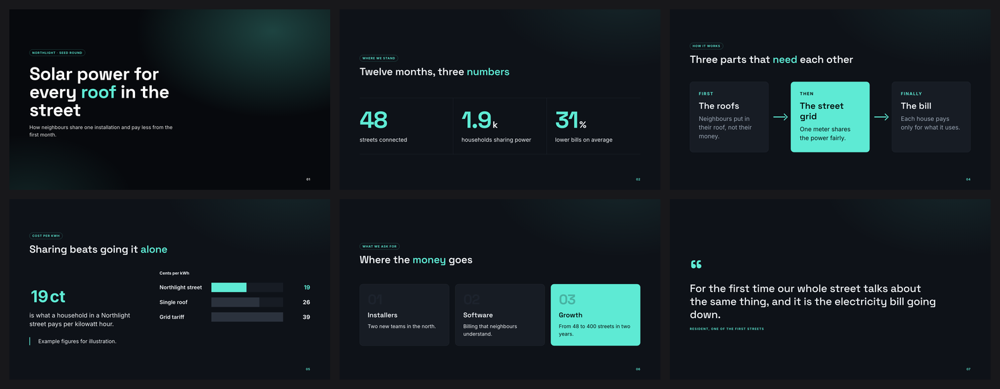
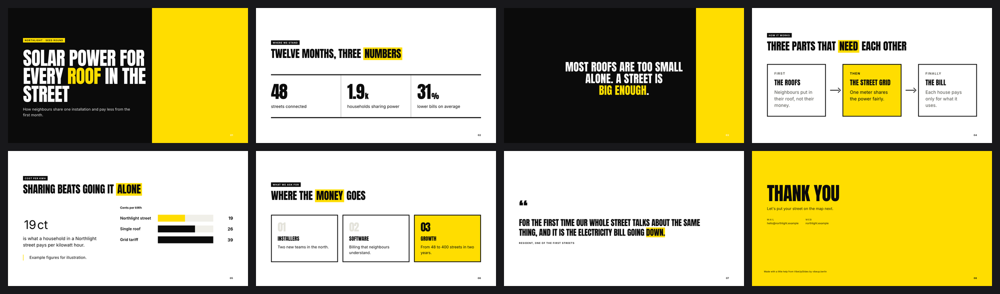
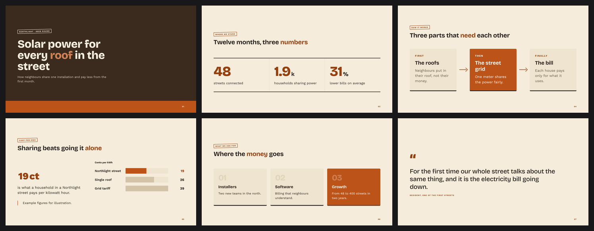
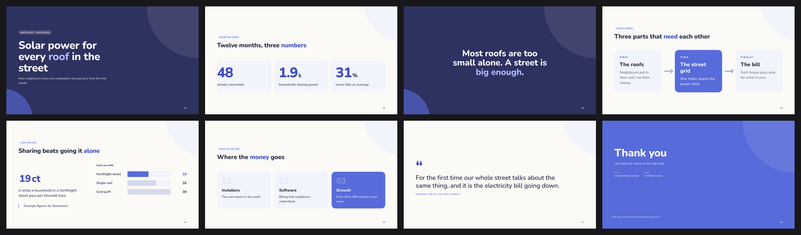

# VibeUpSlides

**Presentations that look like your company and sound like it, built by Claude in seconds.**

VibeUpSlides is a set of four agent skills for Claude. Point it at your website once, and it learns
your colours, typefaces, logo, icons, photo style and the way your company writes. From then on you
say what the deck is for, and Claude helps with the argument, writes every slide in your voice and
builds the deck from your own master slides. No brand yet? It develops a look with you from
examples you like, or from one of nine styles of its own.



<sub>One deck, six of its looks: grid, magazine, night, poster, workshop and light (manifest and shimmer are not shown yet). "Northlight" is an
invented company used for every example here.</sub>

## What it feels like

> Take our design from https://example.com and set up our slides.

Claude reads the site, builds your brand library and shows you the master slides. You say what is
off ("the accent is too loud, use the dark blue for charts"), and it changes the library, not one
deck.

> Build a ten-minute pitch deck for Thursday. Investors, seed round, we need to explain why now.

Claude asks a few questions about the audience and the one thing they should remember, proposes a
line of argument on a researched structure, writes the slides in your voice and builds the deck.
You get one HTML file that runs offline in any browser, with presenter view, PDF export and an
editing mode built in.

> Make slide 4 a comparison against the grid tariff, and add a German version.

Changes go into the deck's content file; the look, the checks and both languages stay in step.

## The same deck in six of its looks

Every look is a full set of master slides: the content stays the same, the design carries it.



<details>
<summary><b>See the whole example deck in each style</b></summary>

**Grid**: strict and clear, much white, one signal colour. For consulting, technology, research.



**Magazine**: a large serif, warm paper, fine rules, the accent word in italics. For culture,
education, talks with a point of view.



**Night**: deep ground, one colour that glows, a technical typeface. For software, data, product
launches, investor pitches.



**Poster**: huge condensed capitals, flat colour, hard contrast. For campaigns, events, young
brands.



**Workshop**: earthy colours on sand, sturdy type, labels like stamps. For crafts, food, clubs,
local businesses.



**Light**: soft pastels, round corners, circles instead of edges. For health and care, education,
communities.



</details>

With your own brand, the masters come from your website and documents instead: your colours, your
typefaces, your icons, arrows and shapes, your photos, and slides that belong to your brand.

## The four skills

| Skill | When | What it does |
|---|---|---|
| **vs-build** | once per brand | Reads your website, your documents (style guide PDF, PowerPoint master, logos, fonts) and a few of your texts, and builds a brand library: style guide, stylesheet, your own master slides, icons, arrows, graphic elements, photo style, typefaces, and a voice profile of how your company writes |
| **vs-design** | when you have no brand | Develops a look of your own from examples you like (slides, a web page, pictures), or lets you choose one of nine styles, shows the options side by side on the same slides, and lets the look grow with what you correct |
| **vs-create** | for every deck | Asks what the deck is for, helps with the content on researched structures (pitch, keynote, sales, proposal, consulting, conference talk, workshop), writes it in your voice and builds it from the library in seconds |
| **vs-update** | when there is something new | Updates the skills and the framework and tells you what changed |

## Install

**Claude Code and other agents** (as skills):

```bash
npx skills add mfoureyes/vibeupslides
```

**Claude Code** (as a plugin):

```text
/plugin marketplace add mfoureyes/vibeupslides
/plugin install vibeupslides@vibeupslides
```

**Cowork**: either add the GitHub repository `mfoureyes/vibeupslides` as a plugin marketplace in
Cowork's plugin settings and install `vibeupslides` from it, or download
[`vibeupslides.plugin`](https://github.com/mfoureyes/vibeupslides/releases/latest/download/vibeupslides.plugin)
from the latest release, add it to a chat and ask Claude to install it; Cowork then offers to save
the plugin.

Updates: the skills check once a day whether a newer version is published and tell you; say
"update VibeUpSlides" to get it.

## What a deck can do

One self-contained HTML file that runs offline in any browser:

- **Presenter view** (M): current and next slide, speaker notes, clock, elapsed time
- **Editing built in**: press the pencil, type into the slides, move, copy and delete slides,
  insert a new one from your masters; Chrome and Edge save straight into the file
- **Timer slides** and **quiz slides**, run from the slide or from the presenter view
- **Motion**: eight motion sets and one copied from your website; counters, growing bars, line
  charts, click steps in reading order
- **Video** and embedded players; a **reading version** of the same deck to send afterwards
- **PDF export** inside the deck (P), searchable; vector PDFs and handouts from the build
- **One or two languages** in one file (L), light and dark (D)
- Outline, overview, deep links, swipe on tablets

## How it works

**A framework, not a page generator.** A deck is a short content file that names master slides
and fills their slots; the framework renders it, embeds fonts, logos and images, and checks every
slide. A build takes a few seconds. New markup is written only when a deck needs a form the
library does not have, and then it becomes a master slide.

**Your words, not only your colours.** The onboarding measures how the company writes (how readers
are addressed, sentence length, its own terms) and records it as a voice profile with real
sentences and before-and-after pairs. Every build checks each slide against those rules.

**Every text can be read.** Each build measures every text on every slide: type too small, too
little contrast to what is behind it (photos included), text cut off, at the edge or on top of
other text is named by slide, and a deck with such a finding is not finished.

**What your decks share.** A team slide, the address, a key figure live once in the brand library.
Decks name them instead of copying them, and after a change `vs.py refresh` brings every deck up
to date.

**A library that grows.** When a slide written by hand comes up again, the agent makes it a master
or a part of the brand, so every deck uses the same one and a change reaches all of them.

**Editable like a slide program.** `vs.py edit <deck>` opens a deck in the browser with undo,
reordering and duplication; every change is written back into the content file. Changes made with
the pencil in a sent file come back with `vs.py apply`, and the agent corrects and translates what
you typed.

**One local folder.**

```
~/vibeupslides/
  framework/            the engine, replaced by updates
  library/<brand>/      brand.json  styleguide.md  voice.md  theme.css  masters/  motion/  shared/  elements/  fonts/  logos/  images/
  decks/<deck>/         deck.json  sources/  research/  images/  the built HTML
```

In Cowork the session runs in the cloud: brands and decks are kept as one file,
`vibeupslides-workspace.zip`, in the folder you connect, next to the decks that were built.

**One command.** Everything the skills do runs through `python3 ~/vibeupslides/vs.py`, so you can
allow it once instead of confirming every step. The first run creates the folder with its own
Python environment (Pillow, Playwright, Chromium).

## Typefaces

Decks only embed fonts that are clearly allowed. Open typefaces (Google Fonts and the like) are
used at once. Files a site serves itself wait until you confirm your licence covers embedding.
Typefaces from font services are named, and you supply the files if you have them; until then an
open stand-in is used and marked as one.

## Without an agent

```bash
python3 skills/vs-update/framework/vs.py init
```

```bash
python3 ~/vibeupslides/vs.py analyze https://example.com --brand example
```

```bash
python3 ~/vibeupslides/vs.py new kickoff --brand example
```

```bash
python3 ~/vibeupslides/vs.py build kickoff
```

`vs.py help` lists all commands. The deck file is described in
[deck-format.md](skills/vs-create/references/deck-format.md), master slides in
[masters.md](skills/vs-build/references/masters.md).

## Test

```bash
python3 tests/smoke.py
```

Sets up a temporary workspace, builds a library preview and a deck in two languages and drives the
deck in headless Chromium: paging, click steps, language switch, timer, quiz, PDF export,
presenter view, and the update path.

## A word on rights

Read brands you are allowed to use: your own organisation's, or a client's who asked you to.
Typefaces stay under their foundry's licence. Use other organisations' logos and photos of people
only with consent.

## Licence

MIT, see [LICENSE](LICENSE). Decks embed [jsPDF](https://github.com/parallax/jsPDF) and
[modern-screenshot](https://github.com/qq15725/modern-screenshot), both MIT
([notices](skills/vs-update/framework/js/LICENSES.txt)).
